# HALO Technologies — Private AI PR-Review Bot Reference Architecture

[](./.github/workflows/pr-review.yml)
[](./docker/docker-compose.pr-reviewer.yml)
[](#1-end-to-end-system-architecture)
[](#1-end-to-end-system-architecture)

> **Executive Summary:** Sanitized reference architecture of the automated Pull Request review pipeline engineered during my **DevOps & AI Automation Internship at HALO Technologies (Apr 2026 – Sep 2026)**. By combining **GitHub Actions**, **Docker**, **Hermes Agent**, and **Honcho Memory** with **Local LLM Inference**, this architecture kept 100% of proprietary financial/software code context on-premise, aligned automated reviews with internal engineering standards, and eliminated external API token costs.

---

## 1. End-to-End System Architecture

```mermaid
flowchart LR
    A["Developer PR Opened\n(GitHub Pull Request)"] --> B["GitHub Actions Trigger\n(.github/workflows/pr-review.yml)"]
    B --> C["Dockerized Self-Hosted Runner\n(Air-Gapped Internal Bridge)"]
    C --> D["Hermes Agent + Honcho Memory\n(Internal Engineering Standards & Past QC)"]
    D --> E["Local LLM Inference\n(Zero External Token Leakage / $0 API Cost)"]
    E --> F["Automated PR Diff Review Comment\n(Inline Security, Style & Architecture Feedback)"]

    style A fill:#111827,stroke:#60a5fa,stroke-width:1.5px,color:#f9fafb
    style B fill:#111827,stroke:#3b82f6,stroke-width:1.5px,color:#f9fafb
    style C fill:#111827,stroke:#06b6d4,stroke-width:1.5px,color:#f9fafb
    style D fill:#1f1209,stroke:#ff5f1f,stroke-width:2px,color:#ffedd5
    style E fill:#0f1a14,stroke:#22c55e,stroke-width:2px,color:#dcfce7
    style F fill:#111827,stroke:#a855f7,stroke-width:1.5px,color:#f9fafb
```



---

## 2. Key Architectural Pillars

1. **Zero External Token Leakage (`internal: true` Docker Network):**
   Proprietary source code diffs never leave the self-hosted runner boundary. The `airgapped-review-net` bridge network in [`docker/docker-compose.pr-reviewer.yml`](./docker/docker-compose.pr-reviewer.yml) blocks outbound internet traffic during inference.
2. **Persistent Engineering Standards via Honcho Memory:**
   Rather than relying on static prompts, **Honcho Memory** stores team-specific architectural conventions, CTO review preferences, and historical false-positive corrections—allowing the **Hermes Agent** to retrieve relevant repository conventions before evaluating each diff hunk.
3. **Deterministic CI/CD Feedback Loop:**
   Triggered automatically on `pull_request: [opened, synchronize, reopened]` via [`.github/workflows/pr-review.yml`](./.github/workflows/pr-review.yml), posting structured severity-tagged markdown comments directly back to the PR timeline.

---

## 3. Visual Example of Automated PR Review Output

Below is a sanitized example of the automated comment posted by the **Hermes + Honcho PR Review Bot** on a pull request:

> ### 🤖 Hermes + Honcho Automated PR Review (`halo-engineering-standards-v2`)
> **PR:** `#418 — Feat: Add batch portfolio reconciliation endpoint`  
> **Inference Runtime:** `Local LLM (On-Premise Runner) · 0 External Tokens · 14.2s`  
> **Honcho Context Matched:** `ADR-014 (Idempotent Batch Writes)`, `SEC-007 (SQL Parameterization)`
>
> | Severity | File & Line | Finding & Internal Standard Reference | Recommended Fix |
> | :--- | :--- | :--- | :--- |
> | 🔴 **CRITICAL** | `src/services/reconcile.py:84` | **Unbounded Batch Transaction (`ADR-014`):** Iterating over `portfolio_ids` inside a single DB transaction risks lock contention above 500 records. | Chunk `portfolio_ids` into batches of `250` using `itertools.batched` with explicit savepoints. |
> | 🟡 **WARNING** | `src/api/routes.py:42` | **Missing Request Idempotency Key (`STD-API-09`):** `POST /v1/reconcile/batch` mutates ledger state without validating `X-Idempotency-Key`. | Require `X-Idempotency-Key` header and cache in Redis for 24h. |
> | 🟢 **NIT / STYLE** | `tests/test_reconcile.py:19` | **Fixture Isolation (`QA-003`):** Shared mutable mock dictionary across parameterized test cases. | Wrap fixture in `copy.deepcopy()` or scope `@pytest.fixture(scope="function")`. |
>
> **Summary Verdict:** Changes requested on `src/services/reconcile.py` before merge.

---

## 4. Repository Structure

```text
private-ai-pr-reviewer-blueprint/
├── .github/workflows/
│   └── pr-review.yml                  # Sanitized GitHub Actions workflow trigger
├── docker/
│   └── docker-compose.pr-reviewer.yml # Air-gapped Hermes + Honcho + Local LLM stack
└── README.md                          # Architecture blueprint & visual output sample
```
